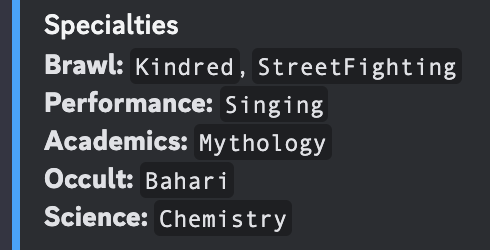
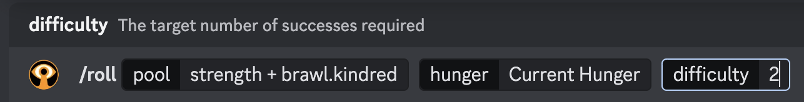
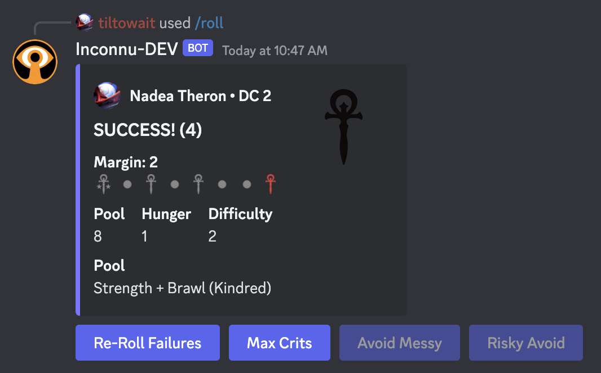

# Specialties

You can add specialties in the [character wizard](creating-a-character.md) or later, with `/specialties add`.

> [!NOTE]
> **Adding specialties**
>
> ```
> /specialties add specialties:<TRAIT1>=<SPEC1>,<SPEC2>,...<SPECN> [TRAIT2]=...
> ```

You can add several specialties at once.

> [!TIP]
> **Example:** Nadea has a Medicine specialty called _Cadavers_.
>
> ```
> /specialties add specialties:Medicine=Cadavers
> ```


Removing them uses the same syntax:

> [!WARNING]
> **Removing specialties**
>
> ```
> /specialties remove specialties:<TRAIT1>=<SPEC1>,[SPEC2]...
> ```

### Listing specialties

`/traits list` shows your specialties near the bottom:



### Rolling

To roll with a specialty, use dot syntax: a Brawl specialty called Kindred is `brawl.kindred`.



> [!NOTE]
> Shorthand works here, too: `brawl.kin`, `b.k`, or even `.k`, as long as it's unambiguous.

The specialty adds a die to your pool and shows in parentheses after the Skill, like "Brawl (Kindred)".


