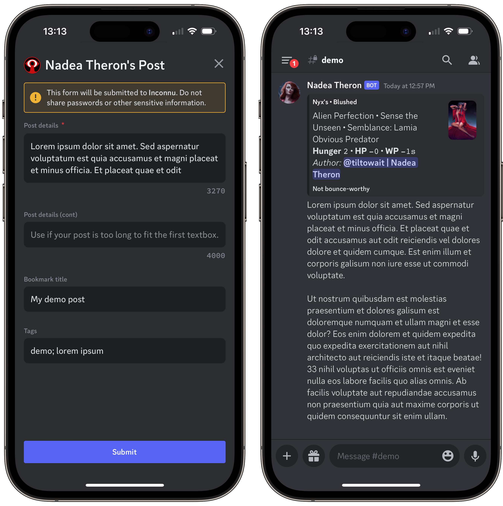
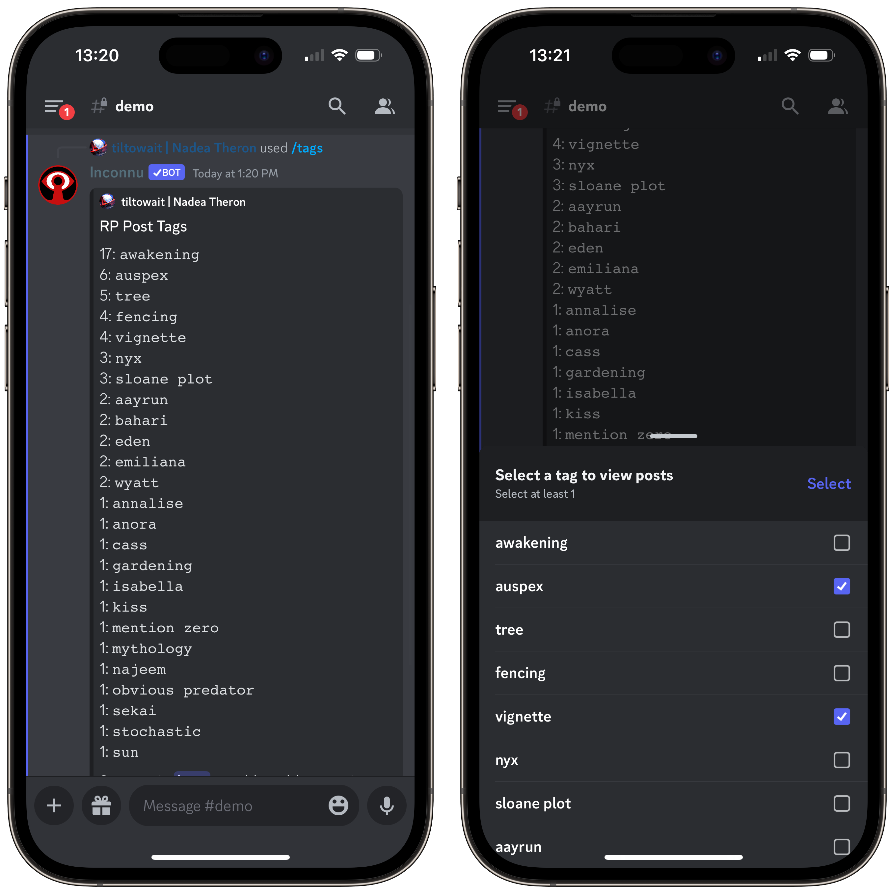

# Roleposting

> [!IMPORTANT]
> **Roleposting is for supporters.** [Become a patron](https://www.patreon.com/tiltowait) of any tier to post as your characters.

Roleposting lets you post a message "from" your character rather than your Discord username. It ties in to your **Inconnu** characters' stats and lets you tag, bookmark, and search your posts.

> [!TIP]
> **If your premium membership lapses, you keep your old posts!** You can still edit and delete them and view your bookmarks and tags.

## /post

Opens a dialogue where you write your post: up to **8000 characters** across two fields. **Inconnu** splits long posts across several messages as needed.

> [!NOTE]
> **Tip:** Write your post in an external editor or the main Discord text box, so you can look at other posts without losing your progress.

| Option | Description | Notes |
| --- | --- | --- |
| `character` | The character to post as | |
| `mentions` | Users, roles, and channels to mention | Start with `@` or `#` |
| `blush` | Is Blush of Life active? | This post only |
| `hunger` | The vampire's Hunger | This post only |
| `location` | Where the scene is taking place | This post only |
| `merits` | Obvious or important Merits | This post only |
| `flaws` | Obvious or important Flaws | This post only |
| `temporary` | Temporary effects | This post only |
| `display_header` | Whether to show the [RP header](../command-reference/characters.md#rp-headers) above the post | Default `True` |

To change "this post only" options permanently, [update the header](../command-reference/characters.md#update-header).

### Bookmarks and tags

In the dialogue, you can give the post a **bookmark title**, which lists it in `/bookmarks`, and **tags**, separated by semicolons, for `/tags`. Players use tags to track awakening scenes, Discipline use, rolls of particular Traits, scenes with particular characters, and more.

### Editing and deleting

Right-click your post and choose **Apps → Post: Edit** or **Apps → Post: Delete**. On mobile, long-press the message and tap **Apps**. A long post is split across several messages, so you edit each one separately, up to 2000 characters.

## /pmnh

A shortcut for `/post` with `mentions` required and no header ("post, mentions, no header"). It takes the same options, and `display_header:True` adds the header back.

## /bookmarks

Lists your bookmarked posts, newest first. Click a bookmark's title to jump to the post.

> [!TIP]
> Only you can see your bookmarks, so call them whatever you like.

## /tags

Lists your tags, most-used first, with how many times you've used each. Select tags to see the posts that have all of them, and click the character name to jump to a post.

> [!TIP]
> Only you can see your tags, so call them whatever you like.

## /search

Discord's search has trouble with Roleposts. In particular, `from:` doesn't work with them. `/search` finds your posts, or another player's.

> [!TIP]
> `/search` **doesn't** require premium. Anyone can search a premium user's posts.

Click a result's character name or snippet to jump to the post.

| Option | Description | Notes |
| --- | --- | --- |
| `user` | The user who made the post | Required |
| `content` | Text in the post | |
| `character` | The character's name | The name when the post was made |
| `mentioning` | A user the post mentioned | The author must have used `mentions` |
| `after` | Only posts after a date | `YYYY-MM-DD` |
| `before` | Only posts before a date | `YYYY-MM-DD` |
| `hidden` | Show the results only to you | Default `True` |
| `summary` | Show a list of snippets instead of full posts | Default `False` |
| `sort_order` | `Most relevant`, `Least relevant`, `Newest`, or `Oldest` | Default `Most relevant`, or `Newest` without `content` |

> [!WARNING]
> **Deleted posts** don't appear in `/search`, `/bookmarks`, or `/tags`.

## Server setup

Admins should:

* [x] Re-invite **Inconnu** with `/invite` if it was added before July 2023 (see [Troubleshooting](#troubleshooting)).
* [x] Set the **Rolepost changelog channel** and **Rolepost deletion channel** in [`/settings scope:Server`](../advanced/server-settings.md#rolepost-changelog-channel).
* [x] Try `/post`!

### Changelog channel

When someone edits a post, **Inconnu** posts a notice in the changelog channel. It links to the post, shows what was added and removed, and links to the post's full history on the **Inconnu** website.

### Deletion channel

When someone deletes a post, **Inconnu** posts a notice in the deletion channel, with the author, the channel, the post's contents, and a link to the post's record on the **Inconnu** website. It can be the same channel as the changelog.

> [!WARNING]
> Posts deleted in bulk, or by deleting their channel, get no notice.

## Troubleshooting

Roleposting needs the _Manage Webhooks_ permission. **If Inconnu was invited before July 2023,** re-invite it to add this permission: use `/invite` and click the link. You shouldn't need to kick the bot first, but if re-inviting doesn't work, kick it and invite it again.

> [!TIP]
> **Inconnu** keeps data for 30 days after being kicked, so kicking and re-inviting it **won't delete your players' characters.**
