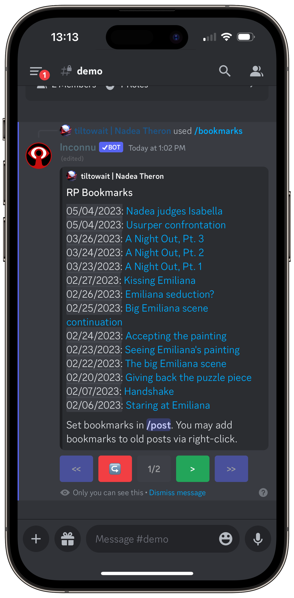

# /bookmarks

The `/bookmarks` command shows you a list of your bookmarked posts, starting with the most recent. Clicking a bookmark title will instantly jump you to that post.

> [!TIP]
> Only you may see your bookmarks, so feel free to call them whatever you like.

> [!WARNING]
> **If your post was deleted,** it will not show in `/bookmarks`.
