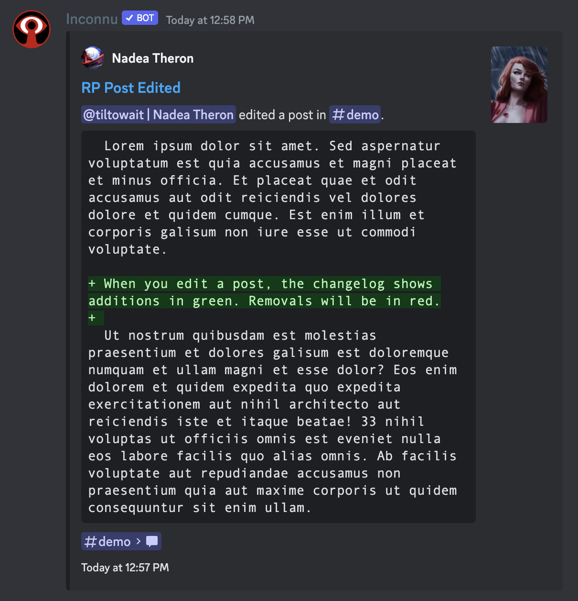
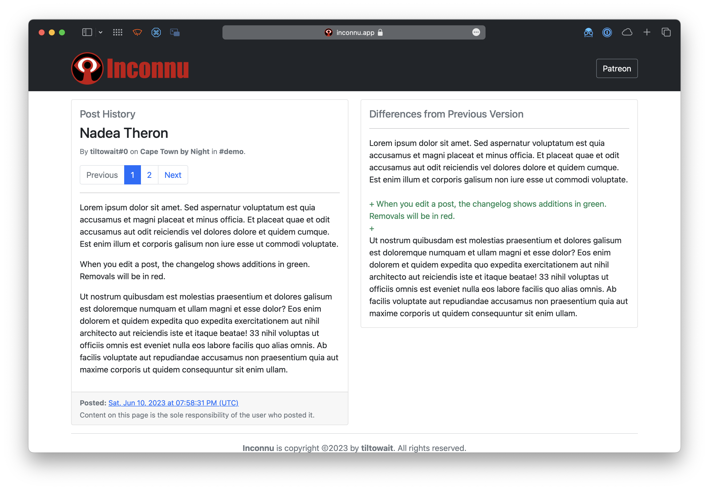

# RP changelog

### Post updates

Server admins may specify a "changelog" channel in `/settings scope:Server`. When this channel is set, **Inconnu** will notify whenever a user edits their `/post`.

This changelog contains a link to the edited post, an indication of what was added/removed, and a URL to the **Inconnu** website's post viewer, which allows you to view all of the post's past history.

### Post deletions

In addition to a changelog channel, server admins may set a "deletions" channel in `/settings scope:Server` that notifies when an RP post has been deleted. This channel may be separate from the changelog channel or the same.

The notice indicates the author, the channel where the message existed, the post's contents, and a link to the post's permanent record on the **Inconnu** website.

> [!WARNING]
> If the post was deleted in bulk or due to a channel deletion, no notice will be posted.
